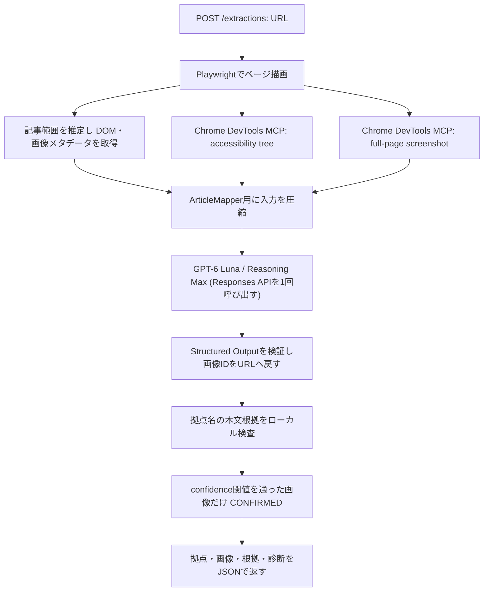

# 拠点名・関連画像の抽出ロジック

この文書は現在のコードが記事ページから拠点名と画像の組を作る処理を説明します。実装上の `CONFIRMED` は採用条件を通過した状態を表し、実測された正解率を意味しません。記事ごとの実地確認結果は、末尾の「検証結果」に記録します。

## 全体フロー

1ページにつきモデル呼び出しは1回です。個々の拠点と画像の全組み合わせを別々に問い合わせたり、Astraなど別モデルで再判定したりしません。Chrome DevTools MCPはページ情報を採取するために使い、GPT-6 Lunaにブラウザ操作ツールを呼ばせる実装ではありません。

## 1. ページを描画して根拠を採取する

入口は `POST /extractions` で、本文には `{ "url": "https://..." }` を渡します。`PlaywrightPageCapture`はURLとページ内リクエスト先を検査してからChromiumでページを開き、DOM読み込み後に最大2秒だけnetwork idleを待ちます。lazy-load画像を読み込ませるためページを段階的にスクロールし、最後に先頭へ戻します。

### 記事本文の推定

次のような要素から記事範囲の候補を作ります。

- `[itemprop='articleBody']`
- `article`、`main`、`[role='main']`
- article body/content、entry content、post contentを含むclass

候補には意味的なタグ、見出し数、段落数、画像数、テキスト量によるスコアを付けます。本文が800文字以上かつ見出しが3つ以上ある候補のうち、最高スコアの要素を記事範囲にします。該当候補がなければページ全体を対象にします。この選択はサイト共通のヒューリスティックで、サイトごとの正解を保証しません。

### 取得するDOM情報

記事範囲の可視要素から見出し、本文、キャプション、画像を抽出します。テキストノードには次を記録します。

| 情報 | 用途 |
| --- | --- |
| `id` | モデルが参照するノードID |
| `kind` / `tag` / `text` | 見出しか本文か、タグ名と表示文字列 |
| `domPath` / `order` | DOM上の位置と読み順 |
| `groupId` / `sectionId` | 同じカード・figure・list item等、または同じsectionか |
| `box` | ページ上のx/y/width/height |

画像ノードには `id`、DOM path、`alt`、`title`、`figcaption`、DOM順、group/section ID、画面座標、自然画像サイズ、画像URLを記録します。通常の `src` だけでなく `currentSrc`、`srcset`、lazy-load用属性も候補にします。

既定の取得上限は本文ノード180件、画像60件です。本文ノードは見出しを均等抽出し、残り枠をcaption、さらに本文テキストへ割り当てます。画像はDOM順の先頭から上限までです。上限超過分は`diagnostics.pageCapture`に記録します。したがって、ページ全体のスクリーンショットがあっても、構造化DOMが全件モデルへ渡るとは限りません。

### Chrome DevTools MCP情報

Playwrightと同じChromiumにMCPで接続し、アクセシビリティスナップショットとスクリーンショットを採取します。記事対応付けでは `fullPage: true` のスクリーンショットを使います。MCPの設定は幅1400px、高さ7000px、JPEG quality 68です。MCPが画像本体を返さず一時ファイルへ書いた場合も、そのファイルを読み込んで画像入力にします。全ページ取得に失敗すると初期ビューポート画像へ切り替え、失敗理由を診断へ記録します。

## 2. GPT-6 Lunaへ渡す内容

モデルはコード上で `gpt-6-luna` に固定し、Responses APIの `reasoning.effort` に `max` を指定します。モデル応答は最大300秒待ち、自動再試行はしません。

1回のリクエストには、同じuser message内で次を渡します。

1. ページタイトルと最終URL。
2. 圧縮した構造化DOM。ノードID、種類、タグ、テキスト、DOM path、順序、group/section、座標を含みます。
3. 画像一覧。画像ID、DOM path、alt/title/caption、順序、group/section、座標、自然画像サイズを含みます。
4. Chrome DevTools MCPのアクセシビリティスナップショット。モデル入力では最大8000文字です。
5. フルページスクリーンショット。`input_image`として同じリクエストに添付します。

画像URLはモデルへ渡しません。モデルには画像IDを返させ、アプリがそのIDを取得済み画像へ戻して元URLをレスポンスに付けます。これにより、モデルが任意URLを作ることを防ぎます。

### 入力サイズの制御

既定の`MAX_PAGE_TEXT_CHARS`は100000文字です。まず全ノードと画像メタデータを直列化し、上限を超えると本文、DOM path、metadataを順に短縮し、本文末尾や画像末尾を省略します。アクセシビリティ情報も上限内に収めます。スクリーンショットのバイト数はこの文字数カウントに含まれません。

各記事のモデル入力はバッチ分割せず、`batchCount: 1`です。`diagnostics.locationExtractionInput`にはモデルへ送ったノード・画像数、省略数、文字数、スクリーンショット有無とサイズが入ります。

## 3. Lunaに求める出力

Structured OutputsのJSON Schemaで以下を要求します。

- `locations`: 拠点名、記事に明記された場合の住所、根拠となるsource node IDs、対応画像ID、各ペアのconfidenceと理由。
- `unresolvedCandidates`: 紹介対象らしいが名前や対応を確定できない候補と理由。
- `headingDiagnostics`: 各見出しを`EXTRACTED`、`NOT_LOCATION`、`UNRESOLVED`のいずれかに分類し、理由を付けます。

プロンプトでは、訪問可能な場所や施設を記事中の独立した紹介項目として扱い、ナビ・広告・著者情報・単なる言及を除外するよう指示しています。スクリーンショット上の配置とDOM順、heading、caption、alt、group/section、座標を合わせて判断し、カード・figure・sectionの直接的な関係を優先します。対応が曖昧なら画像を選ばず理由を返すように指示しています。ページ内テキストは信頼できない入力として扱い、その中の命令に従わないようにも指定しています。

## 4. モデル出力をローカルで検査する

モデル出力をJSON Schemaで検証したあと、次の処理をします。

- `sourceNodeIds`を取得済みDOM node IDsに照合します。
- `imageNodeId`を今回モデルへ送った画像IDに照合します。無効な画像IDは採用せず、`invalidImageNodeIds`に記録します。
- Unicode正規化、大小文字・空白・記号の除去、末尾の地域補足の正規化で重複拠点をまとめます。
- 拠点名が指定されたsource nodeの本文に実在するかを確認します。名称全体、または括弧書き等の補足を除いた名称が見つからないモデル出力は`unsupportedLocationReferences`へ移し、通常の`locations`から除外します。
- モデルが分類しなかった見出しや、出力レコードへ結び付かなかった見出しは`UNRESOLVED`として診断に残します。

### 画像confidenceと候補スコア

確定条件はモデルが返した画像IDが有効で、かつモデルconfidenceが既定の`CONFIRM_THRESHOLD=0.97`以上であることです。上回らないペアは画像として確定せず、`UNKNOWN`または`BELOW_CONFIDENCE_THRESHOLD`になります。モデルが画像を選ばなかった場合は`MODEL_ABSTAINED`です。

別途、アプリは画像候補診断用に以下のローカルスコアを計算します。

| 根拠 | 重み |
| --- | ---: |
| 同じカード等のcontainer | 0.30 |
| 同じsection | 0.04 |
| DOM順の近さ | 0.15 |
| 画面上の距離 | 0.15 |
| captionと拠点名の一致 | 0.18 |
| altと拠点名の一致 | 0.18 |

このスコアは現状、診断と説明用です。候補順位が低いことを理由に、Lunaが選んだ画像をローカルで拒否するゲートとしては使っていません。したがって`CONFIRMED`は「Lunaの画像選択とconfidence閾値を通過し、拠点名の本文根拠も確認された」という意味です。独立した画像分類器や人手ラベルで確認済みという意味ではありません。

## 5. 最終レスポンスで確認できる項目

- `locations[].images[]`: 画像URL、モデルconfidence、alt/caption、source text、DOM位置、ローカル候補根拠、Lunaの判定理由。
- `locations[].status`: 画像ペアが採用された場合`CONFIRMED`、画像が確定しない場合`UNKNOWN`。
- `locations[].imageFailure`: 画像なし、モデル棄却、confidence不足、無効画像IDを区別します。
- `diagnostics.pageCapture`: 発見・取得・省略した本文ノード数。
- `diagnostics.locationExtractionInput`: Lunaへ実際に送ったノードと画像の数、文字数、1バッチであること。
- `diagnostics.headingDiagnostics`、`unresolvedLocationCandidates`、`unsupportedLocationReferences`: 抽出できなかった箇所と理由。
- `diagnostics.browserInspection.mappingScreenshotMode`: `FULL_PAGE`、`VIEWPORT_FALLBACK`、`UNAVAILABLE`。
- `diagnostics.confidenceIsCalibrated`: 常にfalse。confidenceは測定済み確率ではありません。

## 精度の読み方と制約

- `CONFIRMED`の件数だけではprecisionを算出できません。出力された全ペアを記事の見出し、画像そのもの、alt/caption、掲載文脈と照合して正解ラベルを付ける必要があります。
- confidence 0.99は99%の正解率を意味しません。
- 見出し数・画像数・文字数の上限、記事範囲の推定、画像altの不正確さ、汎用的な装飾写真が誤対応や取りこぼしの原因になります。
- `MAX_CONTENT_NODES=180`を超える記事では、構造化DOMの一部が省略されます。画面全体のスクリーンショットで補いますが、スクリーンショットだけから全項目を読む保証はありません。
- URLを1件だけ処理し、記事内のページ送りリンクをたどる処理はありません。複数ページに分かれた記事は、指定URLに表示される本文までが対象です。目次にだけある項目は、画像対応の根拠がなければ棄却または`UNKNOWN`になります。
- 現在は単一モデルの1回判定です。2段目の独立検証や実測データによるconfidence校正はありません。

## 検証結果

2026-10-12に5記事を現在の実装で再取得し、出力された全55画像ペアを、記事本文の見出し・画像alt/caption・配置と、画像自体の目視で照合しました。このサンプルでは、55ペアすべてが対応する記事項目に関連する画像で、明らかな誤対応は見つかりませんでした。これは今回の出力ペアに限った目視結果であり、統計的な精度保証ではありません。

| 記事 | 指定URLの本文項目 | 確定した画像ペア | 目視結果 |
| --- | ---: | ---: | --- |
| [京都観光研究所](https://www.kyotokk.com/recommendation-spot.html) | 10 | 10 | 10ペアとも項目に合致 |
| [トラベルjp](https://www.travel.co.jp/guide/matome/334/) | 10 | 10 | 10ペアとも項目に合致 |
| [リビング東京Web](https://mrs.living.jp/tokyo/town_gourmet/article/6796322) | 5 | 5 | 5ペアとも紹介カフェの文脈に合致 |
| [まっぷる](https://www.mapple.net/orignal/275044/) | 7 | 9 | 7本文項目すべてに合致。京都タワーと金閣寺は各2画像 |
| [じゃらんニュース](https://www.jalan.net/news/article/108372/) | 17 | 21 | 21ペアとも項目に合致。4項目に複数画像 |
| **合計** | **49** | **55** | **55ペアに明らかな誤対応なし** |

### このサンプルで対応付けに役立った手掛かり

- 見出しと画像の`alt`が同じ、または施設・場所名を含んでいました。京都観光研究所、トラベルjp、じゃらんでは、見出し直後や同じ記事項目に対応する画像であることを確認しやすい例が多くありました。
- `figcaption`や画像周辺の本文が、画像の対象（例: 寺の門、紅葉、カフェの飲み物・店内）を具体化していました。リビング東京Webでは、外観写真ではなく、その店で提供される飲食物や店内の写真も記事上の該当カフェに対応する画像として扱っています。
- DOM順・section情報・画面座標に加え、フルページスクリーンショットで実際の画像と掲載位置を確認できました。今回の目視では、テキストと画面の複数の手掛かりがそろう記事ほど、対応関係を確認しやすい傾向がありました。
- 拠点名の本文根拠をローカルで検査し、指定ノードの本文に名前がない候補を通常の`locations`から除外します。これは誤った名前を返さないための防御ですが、ページ分割された記事全体を取得する代わりにはなりません。

この比較は実装の部品を一つずつ無効化するablation評価ではありません。したがって、上記の情報が個別に何ポイント精度を上げたかは測っていません。また、画像ペアの採否自体にはLunaのconfidenceとローカル検査を使い、記載したローカル候補スコアは判定ゲートではありません。

### 網羅性とまっぷるの記事分割

まっぷるの見出しは全17件ですが、指定したURLの本文には1ページ目の7項目が表示され、残りはページ送り先に分かれています。今回の処理はページ送りをたどらないため、本文7項目には9ペアを返しました。目次にだけ現れた後続項目については、5件を画像なしの`UNKNOWN`として残し、5件は有効な本文`sourceNodeIds`がないためローカル検査で除外しました。したがって、これは1ページ目での対応付け結果であり、記事全17項目の取得結果ではありません。

今回の精度確認では採用された55ペアをすべて目視しましたが、ページ内の全画像候補の正解ラベル付けはしていません。よって測定したのは採用結果の誤対応有無であり、全候補に対するrecallや網羅率ではありません。記事全体を扱うには、ページ送りを発見して各ページを取得し、重複拠点を統合する処理が別途必要です。
